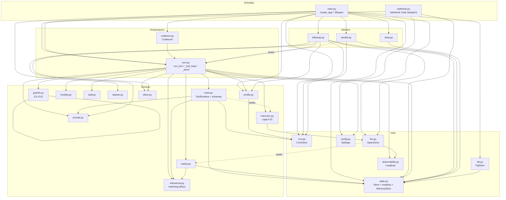
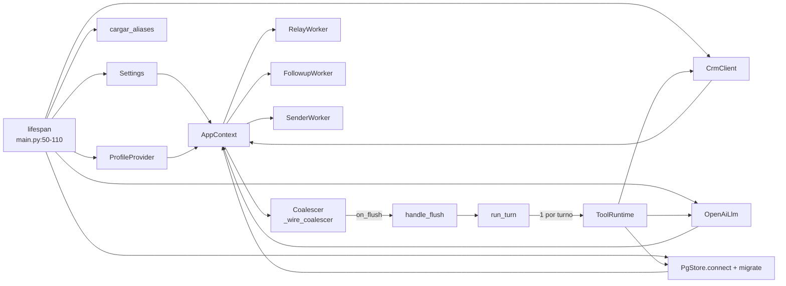

# NEA — Mapa de dependencias (AS-IS)

> Auditoría del grafo de módulos, el ciclo de vida de los objetos centrales y
> los riesgos de acoplamiento/ciclos. Acompaña a [`AS-IS.md`](AS-IS.md).
> SHA `c80f90e`. Cada arista apunta a `ruta:línea` del `import` real.

---

## 1. Diagrama de componentes (Mermaid)

Leyenda: línea sólida = `import` a nivel de módulo; **línea punteada "tardío"**
= `import` dentro de una función (para romper un ciclo de import-time).

---

## 2. Aristas reales (con cita del import)

### 2.1 Arranque / entradas
- `main.py:20-32` importa `coalesce, config, crm, db, followup, llm, profile,
  relay, sender, state, turn, webhook, aliases`.
- `webhook.py:23-25` importa `config.canonical_identity`,
  `state.{AppContext,InboundMessage}`, `turn.handle_flush`.
- `coalesce.py` no importa módulos de app (callback inyectado).

### 2.2 Orquestación
- `turn.py:20-70` importa: `media`, `config`, `crm`, `hostility`,
  `intencion.entender`, `guards`, `llm.LlmExhausted`, `relevancia`
  (`APELATIVOS`, `es_relevante`, `tokens_posible_farmaco`), `stall`, `profile`,
  `prompt`, `wtext`, `state`, y **20+ símbolos de `tools`**.
- `turn.py:273` importa `observability` tardío dentro de `run_turn`.

### 2.3 Dominio
- `tools.py` importa `relevancia`, `state`, `crm`, `prompt` (y `CrmError`,
  `BusinessProfile`, `Conversation`…); importa **`intencion.entender` tardío**
  en `tools.py:2834`.
- `intencion.py:61` importa `llm.OpenAiLlm`.
- `media.py:61-62` importa `state.{AppContext,InboundMessage}` y
  `relevancia.{parece_ocr_sin_medicamento,tokens_farmaco}`.
- `llm.py:205,265` importa **`media.MAX_IMAGE_BYTES` tardío**.
- `llm.py:431` importa `observability.current_trace` tardío.
- `profile.py:26` importa `crm.CrmError`.
- `guards.py`, `hostility.py`, `stall.py`, `wtext.py`, `aliases.py`: hojas
  (solo stdlib), sin dependencias de app.

### 2.4 Infra
- `db.py:15-22` importa modelos de `state`.
- `state.py:15-16` importa `config.Settings` **solo bajo `TYPE_CHECKING`**
  (no en runtime) — evita ciclo `config`↔`state`.
- `state.py:668` importa `aliases.tabla` tardío (dentro de `MemoryStore`).

### 2.5 Workers
- `relay.py:16` importa `state`.
- `followup.py:16-23` importa `crm`, `llm.LlmExhausted`, `profile`, `prompt`,
  `state`, **`turn.{conversation_lock,_agent_tz}` a nivel de módulo**, `wtext`.
- `sender.py:16-17` importa `crm`, `state`; importa **`turn.WA_MAX_CHARS,
  _partir_mensaje_largo` tardío** en `sender.py:56`.

---

## 3. Ciclo de vida de los objetos (quién crea a quién)

- **`AppContext`** (`state.py:715-737`) es el contenedor de dependencias vivas:
  `settings, store, crm, llm, profile, coalescer, relay_wake, turn_locks,
  turn_lock_users, lab_outbox`. Compartido por toda la app; inyectable en tests.
- **`PgStore`** mantiene un pool asyncpg (`db.py:86-87`, min 1 / max 5). El
  `Store` es un `Protocol` (`state.py:181-327`); `MemoryStore` lo implementa en
  memoria para tests.
- **`OpenAiLlm`** puede abrir hasta 4 clientes `AsyncOpenAI` distintos: chat,
  transcripción, visión e intención (este último lo crea `intencion`), según
  `*_API_KEY`/`*_BASE_URL` (`llm.py:75-98`, `intencion.cliente_intencion:340`).
- **`ProfileProvider`** cachea `BusinessProfile` por `conversation_id` con TTL
  300 s y degrada CRM→brief→mínimo (`profile.py:121-170`).
- **`ToolRuntime`** es **uno por turno** (`turn.py:564`); acumula los efectos
  observables del turno. No se reutiliza.
- **`Coalescer`** mantiene buffers y timers por identidad (`coalesce.py:22-23`).
- **Locks por identidad** viven en `AppContext.turn_locks` con refcount en
  `turn_lock_users` (`turn.py:210-242`): se crean y destruyen por conversación.

---

## 4. Niveles (capas lógicas, no paquetes)

| Nivel | Módulos | Dependen de |
|---|---|---|
| 0 Hojas puras | `guards`, `hostility`, `stall`, `wtext`, `aliases`, `config` | stdlib |
| 1 Infra | `state`, `db`, `crm`, `llm`, `observability` | nivel 0 (+ `state`) |
| 2 Dominio | `relevancia`, `intencion`, `media`, `prompt`, `profile`, `tools` | 0–1 |
| 3 Orquestación | `turn`, `coalesce` | 0–2 |
| 4 Entradas/Workers | `webhook`, `main`, `relay`, `followup`, `sender` | 0–3 |

**Violaciones de capa (acoplamiento hacia arriba):**
- `followup` (nivel 4) importa `turn` (nivel 3) a nivel de módulo → aceptable
  (4→3). Pero crea un acoplamiento duro worker→orquestador.
- `tools` (nivel 2) importa `intencion` (nivel 2) tardío — mismo nivel, pero el
  import tardío delata un ciclo latente `tools`↔`intencion` evitado a mano.
- `llm` (nivel 1) importa `media` (nivel 2) tardío → **inversión de capa**
  (1→2): solo para `MAX_IMAGE_BYTES`. Es la inversión más clara del grafo.

---

## 5. Riesgos (resumen; detalle narrativo en `AS-IS.md` §7)

| # | Riesgo | Evidencia | Severidad |
|---|---|---|---|
| R1 | `turn.py` God-module (8.328 LOC, orquestación+dominio+presentación) | `turn.py` entero | Alta |
| R2 | Inversión de capa `llm`→`media` por import tardío | `llm.py:205,265` | Media |
| R3 | Ciclo latente `tools`↔`intencion` (import tardío fail-closed) | `tools.py:2834` | Media |
| R4 | Acoplamiento worker→orquestador `followup`→`turn` | `followup.py:21-22` | Media |
| R5 | Constantes duplicadas (`_PALABRAS_FUNCIONALES`, `_FUNCIONALES`) en 3 sitios | `turn.py:3196`, `tools.py:258`, `relevancia.py` | Media |
| R6 | `MemoryStore` con firmas distintas a `PgStore` (analytics) | `state.py:642-660` vs `db.py:610-671` | Media |
| R7 | Dos rutas de ingesta (`/webhook` firmado vs `/chat` X-API-Key) | `webhook.py:180,290` | Media |
| R8 | Estado de pedido espejado en 3 lugares (PG, ToolRuntime, Conversation en memoria) | `tools.py:4718`, `turn.py:1237` | Media |
| R9 | Capacidad Staff "consent" sin endpoint | `db.marcar_consent:831` sin ruta | Baja |

> Ningún riesgo es un ciclo de import-time real que rompa el arranque hoy
> (los imports tardíos lo evitan). Son deudas de acoplamiento, no fallos.
