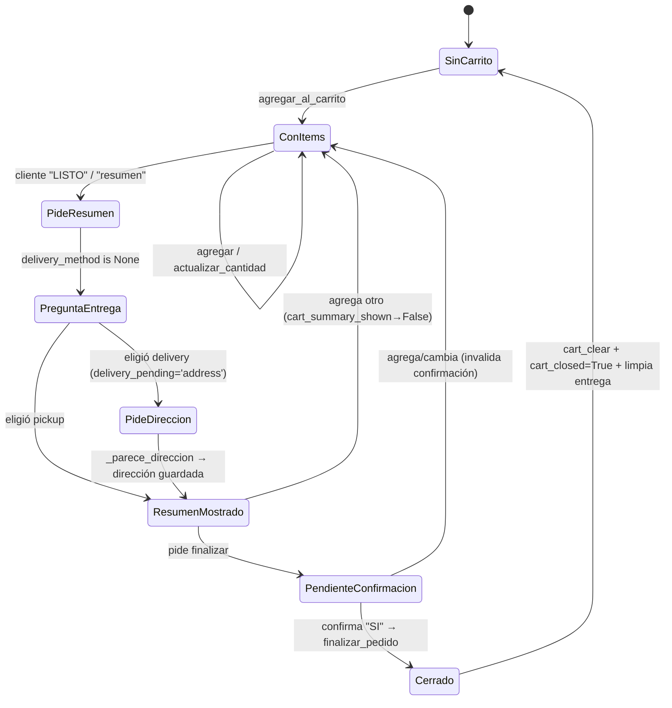

# NEA — Modelo de dominio (TO-BE)

> **Paso 3.** Diseño del dominio de farmacia: actores y límites, entidades,
> máquina de estados del carrito/pedido, reglas transaccionales, contratos tipados
> y evidencia. Acompaña a [`TO-BE.md`](TO-BE.md). **No modifica runtime.**
> **⚠ SUPUESTO** = inferencia a confirmar; **🔸 PENDIENTE** = decisión de producto.

---

## 1. Actores y límites

| Actor | ¿Existe hoy? | Evidencia AS-IS | Límite / alcance |
|---|---|---|---|
| **Cliente (Customer)** | **Sí, activo** | identidad WhatsApp; `FARMACIA_TOOLS`; `turn._resolver_paso_entrega:1328` | su propia conversación y carrito (`conversation_id`), catálogo del tenant |
| **Staff (analytics)** | **Parcial** | `webhook.analytics_top_meds:384`, `analytics_chronic_patients:426`, `X-API-Key` | lectura de analytics del tenant; **sin identidad individual** |
| **Farmacéutico** | **No (brecha)** | — | **🔸 PENDIENTE:** rol clínico responsable de derivación (PLAN §8 q6) |
| **Empleado** | **No (brecha)** | — | **🔸 PENDIENTE:** identificador/autenticación (PLAN §8 q3) |
| **Administrador** | **No (brecha)** | — | **🔸 PENDIENTE:** gestión/configuración del tenant |
| **Farmacia / tenant** | **Sí** | `providerId` (`turn.py:430-431`); `provider_id` en `med_queries`/`patient_profiles` | aislamiento de catálogo, analytics y perfiles |
| **Sistema** | **Sí** | workers `relay`/`followup`/`sender`, backstops, guardas | efectos deterministas sin LLM |

**Regla de aislamiento (PLAN §7):** toda consulta/mutación lleva contexto de
farmacia **validado por backend**; nunca se confía en `pharmacy_id` enviado por el
LLM o extraído del mensaje. Hoy el tenant proviene del contexto CRM, no del mensaje
— se **conserva** esa invariante.

**Brecha de roles (prompt punto 1):** NEA hoy distingue **Customer** vs. **Staff
(por API key)** vs. **agenda legada**. No hay farmacéutico/empleado/administrador
como personas con permisos propios. Se registra; **no se inventan roles**.

---

## 2. Contexto de conversación e identidad

| Concepto | Fuente AS-IS | Nota |
|---|---|---|
| Identidad canónica | `config.canonical_identity:12-22` | `521…`→`52…` (MX); el origen normaliza |
| Conversación | `bot_conversation` + `Conversation` (memoria) | lock por identidad (`turn.py:210-242`) |
| Contexto CRM | `_fetch_context` → `aiEnabled`, `windowOpen`, `providerId` | gate 2 (`turn.py:334-363`) |
| Perfil de negocio | `profile.py` (TTL 300s, degrada CRM→brief→mínimo) | caché por `conversation_id` |
| Allowlist | `ALLOWED_WA_IDS` (`turn.py:288-293`) | se salta en modo lab |

---

## 3. Máquina de estados del carrito / pedido

Basada en el CRM/persistencia reales (`FLOW-ORDERS.md` §1–§6). Estados derivados de
`delivery_pending` (`migrations/012`), `cart_summary_shown` (`009`), `cart_closed`
(`010`) y `bot_cart` (`004`).



**Novedad TO-BE (diseño, [ADR-0007](ADR/ADR-0007-fuente-verdad-pedido.md)):** se hace
explícito el estado **`PendienteConfirmacion`** entre "resumen mostrado" y "cerrado"
— hoy es implícito (el resumen + confirmación "SI" disparan `finalizar_pedido`). Esto
separa **preparar** de **confirmar**.

**🔸 PENDIENTE:** estados posteriores a `Cerrado`
(`aceptado/preparado/entregado/cancelado`) dependen de si el CRM persiste el pedido
(PLAN §8 q1/q2). Hoy `Cerrado` = nota de ficha + carrito limpio, sin seguimiento de
estado real.

### 3.1 Sub-máquina de entrega (`delivery_pending`)

| Valor | Significado | Transición (AS-IS) |
|---|---|---|
| `''` | nada en vuelo | pide resumen y `delivery_method is None` → pregunta método |
| `'method'` | esperando 1/2 | `delivery`→pide dirección; `pickup`→muestra resumen |
| `'address'` | esperando dirección | `_parece_direccion:4049` → guarda y muestra resumen |

Único escritor del menú: `_preguntar_metodo_entrega:1306` (evita menú duplicado).
**El resumen no sale sin método de entrega** (`turn.py:1146-1158`).

---

## 4. Entidades del dominio

### 4.1 Producto de catálogo (campos distintos — PLAN §7)

Nombre comercial, **principio activo**, **concentración**, **forma farmacéutica**,
**presentación**, **laboratorio**, **código/identificador (SKU)**, **precio
USD/Bs**, **disponibilidad**. Fuente: `CrmClient.get_products:300-329`
(`GET /api/bot/products?providerId`), normaliza `{id,nombre}`→`{productId,producto}`.

**⚠ SUPUESTO:** la riqueza real de estos campos depende de la calidad del catálogo
del CRM (PLAN §8 q5). El TO-BE los trata como **campos distintos**, nunca inferidos.

### 4.2 Carrito (`bot_cart`, `migrations/004`)

`conversation_id`, `product_id` (SKU), `producto`, `presentacion`, `laboratorio`,
`cantidad (≥1)`, `precio_usd`, `precio_bs (nullable)`. UNIQUE
`(conversation_id, product_id)` habilita el upsert que **suma** cantidad.

### 4.3 Pedido

Hoy **no es una entidad**: `finalizar_pedido` escribe nota de ficha + `cart_closed`.
Modelo de pedido completo = **🔸 PENDIENTE** ([ADR-0007](ADR/ADR-0007-fuente-verdad-pedido.md)).

### 4.4 Decisión de intención (auditoría)

`intent_decisions` (por término, busque o no, `tools.registrar_decision_intencion:2677`)
y `med_queries.intent_*` (`db.log_med_query:475`).

### 4.5 Perfil de paciente crónico

`patient_profiles` (`db.registrar_consulta_cronica:696`); consent (`marcar_consent:831`)
existe **sin endpoint** (brecha Staff, AS-IS §7 punto 6).

---

## 5. Contratos tipados

### 5.1 Contrato de intención (F15) — formalización aditiva

Desde `Entendimiento` (`intencion.py:166-179`):

```
Entendimiento:
  acto: str            # uno de ACTOS (intencion.py:67-76)
  hay_consulta: bool|None   # None = no concluyente (fail-safe)
  termino: str|None
  confianza: float     # umbral CONFIANZA_MINIMA = 0.35
  motivo: str
  fuente: str          # nombre | capa | fail-safe | desactivada | desvio | llm
```

`ACTOS` = `saludo, cortesia, dato_personal, atributo_producto, dilatoria, reclamo,
consulta_medicamento, otro`. Solo `consulta_medicamento` con `hay_consulta=True`
dispara búsqueda. Contrato inválido (`acto=consulta_medicamento` con
`hay_consulta=False`) se rechaza (`intencion.py:159-161`).

**Ampliación TO-BE (⚠ SUPUESTO, aditiva, no cambia `ACTOS` ni umbral):**
- `entidades`: término normalizado + dosis/forma extraídas (hoy implícitas en
  `camino_rapido` y la capa).
- `evidencia`: por qué se concluyó (ya existe parcialmente como `motivo`/`fuente`).
- `aclaracion_necesaria: bool`: cuando `hay_consulta=None` el turno **pregunta, no
  busca** (comportamiento actual, se nombra explícito).

### 5.2 Resultados de caso de uso

Ver [`TO-BE.md`](TO-BE.md) §4 y [`USE-CASES.md`](USE-CASES.md) §2. Mapeo a hoy:

| Tipado | AS-IS |
|---|---|
| `Encontrado` / `NoEncontrado` / `Ambiguo` | lista de productos / `med_not_found` / `last_options`+`aviso_forma` |
| `NoAutorizado` | `_rechazo_comprension:2894` |
| `Parcial` | Bs omitido (`ver_carrito`, `tools.py:4593-4620`), `principio_inferido` |
| `ProveedorNoDisponible` | `LlmExhausted`, `CrmError`, fail-safe de intención |
| `RequiereConfirmacion` | resumen antes de `finalizar_pedido` |
| `Derivado` | `handoff_reason` + `_safe_handoff` |

### 5.3 Catálogo cerrado de motivos de handoff

`HANDOFF_REASONS = {cliente, modelo, error, ventana, hostilidad,
medicamento_no_disponible}` (`crm.py:84-86`), normalizado por
`canonical_handoff_reason:89`. **🔸 PENDIENTE:** posible motivo `clinico`
([ADR-0006](ADR/ADR-0006-handoff-clinico-fail-closed.md)).

---

## 6. Evidencia requerida por afirmación (prompt punto 6)

Ninguna afirmación comercial/clínica se emite sin su evidencia; sin ella, la guarda
correspondiente veta.

| Afirmación | Evidencia requerida | Fuente AS-IS | Guarda si falta |
|---|---|---|---|
| **Precio** (con dígitos) | precio del catálogo (USD/Bs) para ESE producto | `_formatear_lista_productos`, catálogo | G1/G6 + backstop precio inventado (`turn.py:820-834`) |
| **Disponibilidad / stock** | flag `disponible` del catálogo | `get_products` | G6 |
| **Composición / genérico** | evidencia específica por producto | `hay_evidencia_composicion:206` (**fail-closed**) | G5 |
| **Equivalencia** | NO hay fuente de verdad; `principio_inferido` es **mitigación**, no evidencia | `tools.py:2283-2288` | `_sin_equivalencia_inventada:7100`; **🔸 PENDIENTE** política |
| **Presentación / forma** | campo del catálogo; `aviso_forma` si la pedida no existe | `_filtrar_por_forma`/`_aplicar_forma` | backstop de forma (`turn.py:871-885`) |
| **Estado de pedido** | debe proceder del sistema fuente | hoy: solo nota de ficha | G13 (no afirmar acción no ocurrida) |
| **Acción realizada** (agregué/finalicé) | señal de que la operación ocurrió | `carrito_agregado_turno`, `pedido_finalizado` + `_g13_accion_ocurrio` | G13 |

**⚠ SUPUESTO / requisito TO-BE (PLAN §7):** precio, moneda, disponibilidad y stock
deberían llevar **fuente y momento de consulta**. Hoy el momento **no se persiste
junto al dato mostrado**; añadirlo es trabajo de los Pasos 5/7/10 (no en este paso).

---

## 7. Reglas de idempotencia, concurrencia, expiración y recuperación (prompt punto 8)

| Dimensión | Regla AS-IS | TO-BE |
|---|---|---|
| **Dedup de entrada** | `processed_message` INSERT ON CONFLICT (`db.py:99-108`) | se conserva |
| **Idempotencia de carrito** | upsert suma; `backstop_added_skus` intra-turno; misma cantidad inter-turno no dobla (`tools.py:4319,4351-4378`) | se conserva |
| **Idempotencia de pedido** | **no existe clave de pedido** | cada **intento lógico de confirmación** usa un `order_attempt_id` **único y persistido**; los **reintentos del mismo intento** (timeout, doble webhook, reenvío) **reutilizan** ese identificador; la protección contra duplicados es **atómica**. El hash del carrito **no** es la clave. Mecanismo de concurrencia y persistencia definitivo: ver [ADR-0007](ADR/ADR-0007-fuente-verdad-pedido.md) (parte PENDIENTE del Paso 7) |
| **Concurrencia** | `conversation_lock` por identidad (único mecanismo; sin `FOR UPDATE`) | se conserva; revisar al formalizar pedido |
| **Expiración** | carrito `CART_SESSION_HOURS=12h`; seguimiento `FOLLOWUP_MAX_AGE_HOURS=48h` | se conserva; definir expiración de `PendienteConfirmacion` |
| **Recuperación** | `pending_send` (nunca descarta); `SenderWorker` reintenta; `FollowupWorker` re-engancha | se conserva |
| **Confirmación** | resumen + "SI" → `finalizar_pedido` | explícita como transición `PendienteConfirmacion→Cerrado` |
