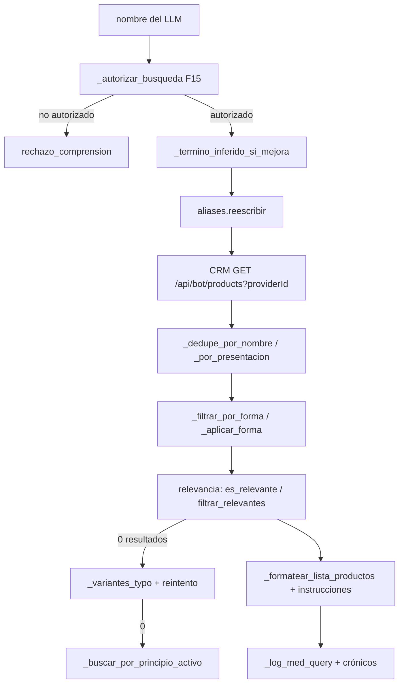

# NEA — Flujo de catálogo, relevancia, media y handoff (AS-IS)

> Cómo NEA entiende lo que el cliente pide y lo resuelve contra el catálogo:
> comprensión (F15), relevancia difusa, alias, precio/disponibilidad, OCR/media
> y handoff. Acompaña a [`AS-IS.md`](AS-IS.md). SHA `c80f90e`.
>
> Pedido/carrito/entrega → [`FLOW-ORDERS.md`](FLOW-ORDERS.md).

---

## 1. Capa de comprensión (F15) — decidir ANTES de buscar

`app/intencion.py`. Decide si el mensaje trae una **consulta de medicamento** (y
cuál es el término) antes de tocar el catálogo. Existe porque el catálogo es
difuso y, sin esta capa, frases como «Vivo en Ciudad Bolivar» generaban 13
búsquedas basura (`intencion.py:1-48`).

**Tres caminos** (`entender:394-494`):
1. `camino_rapido:193` — nombre pelado corto (1–2 palabras, con evidencia de
   dosis/forma/token largo, sin palabra de conversación, sin `?`): decide sin LLM.
2. `capa` (LLM) — todo lo demás; una llamada con contrato JSON cerrado
   (`_SISTEMA:107`), esquema estricto (`_veredicto_desde_json:274`).
3. `fail-safe` — timeout/proveedor caído/JSON inválido → `hay_consulta=None`
   (no concluyente → el turno pregunta, no busca).

Controles: `CONFIANZA_MINIMA=0.35` (`:328`), circuito de corte tras 3 fallos
(`_FALLOS_PARA_CORTE`, `:334`), cliente propio opcional (`cliente_intencion:340`,
patrón `INTENT_*`). Clasificación: `ACTOS:67` (solo `consulta_medicamento`
dispara búsqueda).

**F15.1** (`candidato_obligatorio`, `:363-389`): la capa juzga el **término
candidato**, no el mensaje en general — cierra el hueco por el que `oiga`,
`firma`, `maria fernandez cmp 45231` llegaban al catálogo.

Auditoría: cada veredicto se persiste en `intent_decisions` (busque o no,
`tools.registrar_decision_intencion:2677`) y en `med_queries.intent_*`
(`db.log_med_query:475`).

---

## 2. Búsqueda de medicamento (`_buscar_medicamento`)

`app/tools.py:2957` (≈930 líneas). Pipeline (resumen de altitud):

Puntos clave:
- **Fuente de datos**: `CrmClient.get_products:300-329` (`GET /api/bot/products`),
  que normaliza `{id,nombre}`→`{productId,producto}`.
- **Alias de escritura (F14.4)**: `aliases.reescribir:179` reescribe grafías
  conocidas ANTES de buscar y apaga el fuzzy; semilla en
  `migrations/013_med_aliases.sql`, cargada al arranque
  (`aliases.cargar_desde_store:197`, llamada en `main.py:62`).
- **Fail-safe de alias**: si el término reescrito da 0, se reintenta con el
  original + fuzzy (regla documentada en `aliases.py:28-31`).
- **Typos**: `_variantes_typo:1589` genera variantes; corrección creíble en
  `relevancia.correccion_creible:1080`, anotada en `corregido_desde/_a`.
- **Principio activo**: `_buscar_por_principio_activo:4022` (marca→monodroga) y
  `_marcas_comerciales_de:3923`; lo que el LLM **adivina** se anota en
  `principio_inferido` para NO afirmar equivalencia (`tools.py:2283-2288`).
- **Forma farmacéutica**: `_forma_pedida` / `_filtrar_por_forma` /
  `_aplicar_forma` (`relevancia`/`tools`), con `aviso_forma` cuando la forma
  pedida no existe.

---

## 3. Relevancia (`app/relevancia.py`, 1.226 LOC)

Motor de matching difuso puro (sin IO). Funciones de entrada:

| Función | Línea | Qué decide |
|---|---|---|
| `es_relevante` | 567 | ¿este producto coincide con el término? |
| `es_relevante_estricto` | 836 | versión estricta (para recuperar precio Bs) |
| `filtrar_relevantes` | 881 | filtra la lista del CRM |
| `_levenshtein` / `_typo_aceptable` | 425 / 521 | distancia de edición (≤2, desplazamientos) |
| `_difiere_por_sal` | 447 | clorhidrato/sódico… no cambia el fármaco |
| `tokens_farmaco` / `tokens_senal` | 778 / 534 | tokens significativos |
| `correccion_creible` | 1080 | ¿la corrección por typo es defendible? |
| `hay_senal_de_farmaco` | 1021 | ¿el término parece un fármaco? |
| `parece_ocr_sin_medicamento` | 1200 | descarta OCR que no es medicamento |
| `parece_presentacion_personal` | 1143 | "para mi hijo"… no es producto |

Vocabularios compartidos: `_CATEGORIAS_TERAPEUTICAS` (`tools.py:724`),
`_VIAS_ADMINISTRACION` (`tools.py:785`), `_PALABRAS_FUNCIONALES` (`tools.py:258`),
`APELATIVOS` (`relevancia.py:202`). (Hay duplicación de estos léxicos en
`turn.py`/`relevancia.py` — ver [`DEPENDENCY-MAP.md`](DEPENDENCY-MAP.md) R5.)

---

## 4. Precio y disponibilidad

- **Disponibilidad**: el catálogo devuelve `disponible` por producto; la lista
  se formatea con `_formatear_lista_productos:2190` (orden por precio asc, `💊 N.`).
- **Precio**: USD y Bs del catálogo; `_fmt_ve:1352` formatea al estilo
  venezolano. **Nunca se inventa** (guardas G1/G5/G6/G10 + backstops de precio
  inventado en `turn.py:820-834`).
- **Backstops de lista** (`turn.py:717-912`): si el LLM contradice, desordena,
  omite, reformatea o inventa precios, `run_turn` **reemplaza** el texto por
  `_lista_con_aviso` con los productos reales.
- **Medicamento no encontrado**: set `med_not_found`; el turno informa honesto y
  deja el chat abierto — **no** hace handoff automático (`turn.py:708-712`).

---

## 5. Media y OCR (`app/media.py`)

`describe_item:481` enruta por tipo y nunca lanza (fallback honesto). Handlers:
`_audio:161`, `_image:213`, `_document:387`, `_sticker:416`, `_location:425`,
`_contacts:440`, `_video:450`, `_fallback:460` (`_HANDLERS:469`).

**Imagen / receta (`_image:213`)** — el pipeline más defensivo:
1. Descarga (base64 de Evolution o `GET /api/bot/media` de Meta).
2. OCR con visión (`llm.ocr_image:252`, temperatura 0 determinista, blindaje
   anti-prompt `_parece_prompt_ocr:155`).
3. Puerta de legibilidad: si parece receta (`parece_receta:117`), comprueba
   legibilidad (`llm.lectura_dudosa:238`) y manuscrita (`llm.es_manuscrita:246`);
   una receta **manuscrita o dudosa NO se transcribe** (`MARCA_MANUSCRITA:96`,
   `MARCA_DUDOSA:102`).
4. Descarta OCR que no es medicamento (`parece_ocr_sin_medicamento`).
5. Segunda lectura enfocada si la primera se dejó el nombre
   (`_lectura_incompleta:38`, `PROMPT_OCR_ENFOCADO:22`).
6. Doble lectura de recetas impresas: si dos lecturas no coinciden
   (`_lecturas_coinciden:205`), **no se transcribe**.

El resultado es un **marcador** `[entre corchetes]` que es instrucción NUESTRA,
no texto del cliente; el prompt explica cómo usarlo (`prompt.py:92-99`), y
`turn._texto_cliente_sin_marcadores:5691` lo limpia del historial en turnos
posteriores (salvo el turno en curso) — caso "Hola" que re-ofrecía la foto de
días atrás (`turn.py:473-522`).

**Flujo de receta multi-medicamento** (en `_tool_loop`): `_medicamentos_de_ocr:6364`,
`_terminos_por_envase:6106`, `_resolver_alternativas_de_receta:6315`,
`_formatear_receta:8168`; con presupuesto de tiempo `PRESUPUESTO_BACKSTOP_S=45`
(`turn.py:150`).

Límites: `MAX_MEDIA_BYTES=16MB`, `MAX_IMAGE_BYTES=6MB`, `PDF_MAX_PAGES=10`,
`PDF_MAX_CHARS=8000` (`media.py:66-69`). PDF vía `pypdf` (`_pdf_text:375`).

---

## 6. Handoff (escalado a humano)

- **Marca diferida**: `handoff` solo setea `handoff_reason`
  (`tools._handoff:2643`); la ejecución real (`crm.post_handoff`) ocurre DESPUÉS
  del mensaje de despedida (`turn._safe_handoff:3052`, llamado en `:1194-1195`)
  para no chocar con 409 `ai_paused`.
- **Normalización**: `crm.canonical_handoff_reason:89` mapea el motivo libre del
  LLM al catálogo cerrado `{cliente, modelo, error, ventana, hostilidad,
  medicamento_no_disponible}` (`HANDOFF_REASONS:84`).
- **Determinista** (no depende del LLM): hostilidad al 3er strike
  (`turn.py:697-698`), acusación de fraude G4 (`:702-706`), cliente pide humano
  G9 (`:1063-1066`) y `_pide_hablar_con_humano` en el loop (`turn.py:1511`),
  promesa de escalado G11 (`:1092-1098`).
- **Cancelación**: si hay carrito activo (`turn.py:1188-1193`) o el handoff fue
  por "no disponible" y luego se encontró producto
  (`tools._cancelar_handoff_por_no_disponible:2652`).
- **Reactivación automática**: solo si el handoff previo fue
  `medicamento_no_disponible` y el cliente vuelve (`turn.py:345-357`).

---

## 7. Clasificación de capacidades (catálogo/media/handoff)

| Capacidad | Clase | Símbolo |
|---|---|---|
| Comprensión F15 | transversal (infra de decisión) | `intencion.entender:394` |
| Búsqueda / precio / disponibilidad | **Customer** | `tools._buscar_medicamento:2957` |
| Sugerir genérico | **Customer** | `tools._sugerir_generico:4200` |
| Relevancia / alias / typos | transversal (motor) | `relevancia.*`, `aliases.*` |
| OCR / recetas / audio / pdf | **Customer** | `media.describe_item:481` |
| Clasificación legibilidad receta | transversal (motor) | `llm.lectura_dudosa/es_manuscrita` |
| Info del proveedor | **Customer** | `tools._info_provider:4228` |
| Handoff | transversal | `tools._handoff:2643` + guardas |
| Pacientes crónicos (detección) | **Staff** (deriva de Customer) | `db.registrar_consulta_cronica:696` |
| Agenda (slots/booking) | **legado/agenda** | `tools._propose_slots:2481` … |

**Pendiente de clasificar / confirmar:** el mapeo marca→principio activo del LLM
(`principio_inferido`) es un heurístico transversal que **no** tiene fuente de
verdad en el catálogo (`tools.py:2283-2288`); su rol es "mitigación", no
capacidad — queda marcado como PENDIENTE de política de producto.
