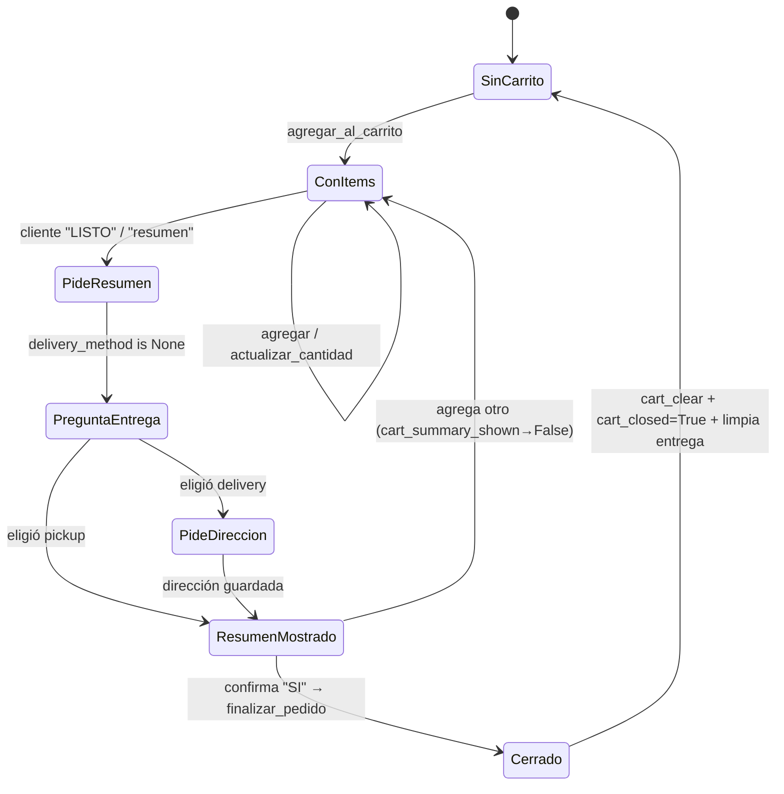

# NEA — Flujo de pedidos: carrito, entrega y cierre (AS-IS)

> Ciclo de vida de un pedido: agregar al carrito → ver resumen → método de
> entrega → finalizar, con su persistencia, estados y backstops. Acompaña a
> [`AS-IS.md`](AS-IS.md) y [`FLOW-CATALOG.md`](FLOW-CATALOG.md). SHA `c80f90e`.
> Clase de todas las capacidades de este documento: **Customer**.

---

## 1. Máquina de estados del pedido

Nota: `ConItems`/`ResumenMostrado` NO cierran el carrito; solo `finalizar_pedido`
lo cierra (`cart_closed`, `migrations/010_cart_closed.sql`).

---

## 2. Agregar al carrito (`agregar_al_carrito`)

`app/tools.py:_agregar_al_carrito:4257`.

- Resuelve **"opción N"** o id alucinado contra `last_options` (la lista real
  que el cliente vio, ordenada por precio) → SKU real (`:4282-4312`).
- **Precios siempre del catálogo** (nunca del LLM); recupera Bs faltante por
  productId → nombre exacto → relevancia estricta única; si ambiguo, lo omite
  (`:4400-4482`).
- **Idempotencia**: no dobla si el backstop ya agregó el SKU este turno
  (`backstop_added_skus`, `:4319`) ni entre turnos si la cantidad coincide
  (`:4351-4378`). "quiero 2 más" sí suma.
- Persiste con `store.cart_add` (upsert `ON CONFLICT (conversation_id,
  product_id)` que **suma** `cantidad`, `db.py:382-397`).
- Si el carrito cambia tras un resumen, resetea `cart_summary_shown=False`
  (`:4512-4516`) para que un "LISTO" no finalice sobre un resumen obsoleto.
- Set `carrito_agregado_turno=True` (señal G13).

`actualizar_cantidad:4532` **reemplaza** (no suma) vía `store.cart_set`
(`db.py:438-457`).

Backstops que FUERZAN `agregar_al_carrito` cuando el LLM no lo llama: resolución
de cantidad/opción en `_tool_loop` (ver `turn._extraer_eleccion_opcion:3542`,
`_es_respuesta_cantidad:3589`, `_cantidad_pedida:4474`).

---

## 3. Resumen del pedido (`ver_carrito`)

`app/tools.py:_ver_carrito:4573`.

- Lee `cart_items` con ventana de sesión `CART_SESSION_HOURS` (default 12 h,
  `config.py:136`): el carrito no acumula ítems de sesiones viejas
  (`db.cart_items:407-433` filtra por `updated_at`).
- Construye un **resumen determinista** (`cart_summary_text`): cada ítem con
  cantidad y subtotal USD | Bs, total, **formas de pago** del tenant
  (`paymenType` de Firestore, recargado si falta, `:4628-4641`) y **método de
  entrega** (`:4644-4653`).
- Omite Bs si algún ítem no lo tiene (no inventa "Bs 0,00", `:4593-4620`).
- Set `cart_summary_shown=True` (`:4588`): este resumen "cierra" el carrito para
  acumular (la próxima consulta arranca uno nuevo salvo que se siga agregando).
- `run_turn` **reemplaza** el texto del LLM por `cart_summary_text` salvo que el
  cliente además esté agregando (`turn.py:929-938`, `_tambien_pide_agregar`).

---

## 4. Paso de entrega (delivery / retiro)

`app/turn.py:_resolver_paso_entrega:1328` (resuelto en código ANTES del LLM,
único punto por el que pasan todos los turnos). Estados en `delivery_pending`
(`migrations/012_delivery.sql`):

| `delivery_pending` | Significado | Transición |
|---|---|---|
| `''` | nada en vuelo | si pide resumen y `delivery_method is None` → pregunta método |
| `'method'` | esperando 1/2 | `delivery`→pide dirección; `pickup`→muestra resumen |
| `'address'` | esperando dirección | `_parece_direccion:4049` → guarda y muestra resumen |

- Único escritor del menú: `_preguntar_metodo_entrega:1306` (evita menú
  duplicado — bug medido en `:1343-1354`).
- Guardado: `runtime.guardar_eleccion_entrega:2405` /
  `guardar_direccion_entrega:2422` (persisten `delivery_method/_address/_pending`
  en PG y espejo en `Conversation`).
- Flexibilidad: si pide el **total** sin contestar el menú, se muestra el resumen
  y se deja la pregunta en vuelo (`:1388-1395`); si el mensaje no responde al
  menú, se limpia y sigue el LLM (`:1398-1405`).
- **El resumen NO sale sin método de entrega**: guard final en `run_turn`
  (`:1146-1158`, `_es_resumen_de_pedido` + `delivery_method` None →
  `_preguntar_metodo_entrega`).
- Backstop PRE-LLM de envío: "quiero que me lo envíen" con carrito → guarda
  delivery y pide dirección; sin carrito → confirma delivery y pregunta
  (`turn.py:602-637`, `_es_peticion_de_envio:3862`).

---

## 5. Finalizar pedido (`finalizar_pedido`)

`app/tools.py:_finalizar_pedido:4682`.

1. Exige carrito no vacío (`carrito_vacio` si no, `:4686-4691`).
2. Registra el pedido como **nota de ficha** en el CRM (`put_ficha` con
   `resultado=pedido` + `notas`, best-effort, `:4700-4705`).
3. `pedido_finalizado=True` (señal G13), `cart_clear` (`:4708`),
   `cart_closed=True` (`:4713`).
4. Limpia TODO el estado del pedido: `delivery_method/_address/_pending=''` y
   `cart_summary_shown=False` (`:4738-4748`) — el próximo pedido vuelve a
   preguntar entrega (hallazgo de auditoría de estado, `:4726-4737`).
5. Decide si repetir formas de pago según si el resumen ya las mostró
   (`summary_shown`, leído FRESCO de la DB, `:4718-4723`).

Backstop que fuerza `finalizar_pedido` si el cliente confirma y el LLM no lo
llama: `_tool_loop` (`turn.py:1967`, con `_quiere_finalizar:3742`,
`_es_confirmacion_resumen:4189`).

---

## 6. Persistencia del pedido

### Tabla `bot_cart` (`migrations/004_bot_cart.sql`)

| Columna | Tipo | Nota |
|---|---|---|
| `id` | BIGSERIAL PK | |
| `conversation_id` | BIGINT FK → bot_conversation ON DELETE CASCADE | |
| `product_id` | TEXT | SKU del catálogo |
| `producto`, `presentacion`, `laboratorio` | TEXT | |
| `cantidad` | INT `CHECK >= 1` | |
| `precio_usd`, `precio_bs` | NUMERIC (nullable) | Bs puede faltar |
| `created_at`, `updated_at` | TIMESTAMPTZ | |

Índices: `idx_bot_cart_conv (conversation_id)`, **`uq_bot_cart_conv_product
(conversation_id, product_id)` UNIQUE** (habilita el upsert que suma cantidad).

### Flags de pedido en `bot_conversation`

| Columna | Migración | Significado |
|---|---|---|
| `last_product` (JSONB) | 005 | último producto (backstop de cantidad) |
| `last_term` (TEXT) | 006 | último término buscado |
| `last_options` (JSONB) | 007 | opciones ordenadas por precio (resolver "opción N") |
| `last_ocr_term` (TEXT) | 011 | término OCR de la última imagen |
| `cart_summary_shown` (BOOL) | 009 | resumen mostrado para ESTE carrito |
| `cart_closed` (BOOL) | 010 | pedido finalizado (arranca carrito nuevo) |
| `delivery_method` / `delivery_address` / `delivery_pending` | 012 | método, dirección, pregunta en vuelo |

### Transacciones, locks, ventanas
- **Lock por conversación**: `conversation_lock` serializa turnos
  (`turn.py:210-242`) — es el único mecanismo de concurrencia del pedido; no hay
  `SELECT … FOR UPDATE` sobre `bot_cart`.
- **Upsert atómico**: `cart_add` usa `ON CONFLICT DO UPDATE` (`db.py:388-392`).
- **Ventana de sesión**: `CART_SESSION_HOURS` (12 h) filtra `cart_items`
  (`db.py:410-417`, `make_interval`); el seguimiento usa
  `FOLLOWUP_MAX_AGE_HOURS` (48 h) en su lugar (`config.py:124-132`).
- **Aislamiento por tenant**: todo `med_queries`/`patient_profiles` lleva
  `provider_id`; el carrito es por `conversation_id` (una conversación es de un
  tenant).

---

## 7. Seguimiento del pedido (follow-up)

`app/followup.py`. Es la cola de "re-enganche" del pedido NO cerrado:

- Se agenda en `run_turn` **solo** si hay pedido abierto y `cart_closed=False`
  (`turn.py:1230-1248`), a `FOLLOWUP_HOURS` (4 h).
- El worker (`FollowupWorker.tick:172`) respeta franja horaria
  (`FOLLOWUP_HOUR_START/END` 9–19), días (`FOLLOWUP_DIAS` L–S) y claim atómico
  (`claim_followup:859`, a lo sumo UN empujón).
- Omite si el cliente ya cerró (`:259-264`), si no hay carrito (`:271-276`), si
  la IA está pausada o la ventana cerró.
- **Backstop anti-invención**: descarta el texto si nombra un medicamento que no
  está en el carrito (`_medicamentos_inventados:46`) o si termina en pregunta
  (`:333-337`). El prompt del empujón es `FOLLOWUP_INSTRUCTION:234` (prohíbe
  terminar en pregunta e inventar el pedido).

---

## 8. Reglas de negocio implícitas del pedido

1. El precio y la disponibilidad **solo** vienen del catálogo (nunca del LLM).
2. El resumen **siempre** muestra formas de pago y método de entrega.
3. No se finaliza un carrito vacío; no se dobla una cantidad re-confirmada.
4. Un pedido cerrado (`cart_closed`) arranca carrito nuevo y limpia entrega.
5. El seguimiento es para el **pedido** no cerrado, nunca un "¿sigues ahí?".
6. El handoff se cancela si hay carrito activo (el pedido manda sobre el
   escalado, `turn.py:1188-1193`).

---

## 9. Contraste con tests

| Aspecto | Test | Nota |
|---|---|---|
| Opción numerada → carrito | `test_f14_busqueda.py::TestF142OpcionNumerada` | cubierto |
| G13 (afirmar pedido sin cerrar) | `test_g13_accion.py` (incl. e2e carrito vacío) | cubierto |
| Tool-loop / respaldo | `test_tool_loop_respaldo.py` (A1–A9) | cubierto a nivel loop |
| **Entrega (delivery/retiro)** | — | **sin test unitario** en `tests/` |
| **Resumen `ver_carrito` / Bs omitido** | — | **sin test** directo (solo vía MemoryStore) |
| **Finalizar / limpieza de estado** | — | **sin test** directo |
| **Seguimiento (FollowupWorker)** | — | **sin test** unitario |

> El pedido end-to-end (agregar→resumen→entrega→finalizar) se ejercita hoy por
> las sondas/harness manuales (ver [`BASELINE.md`](BASELINE.md)), no por el suite
> `pytest`. Es el mayor hueco de cobertura automatizada del flujo de pedidos.
