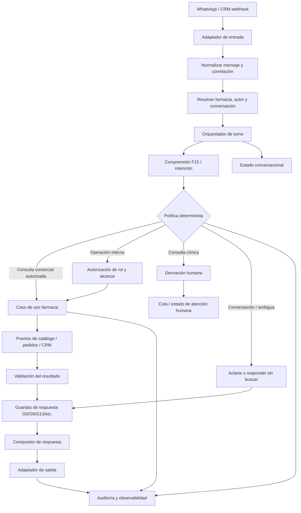

# Plan de modernización arquitectónica de NEA — especialización en farmacia

**Estado:** propuesta ejecutable, todavía no autoriza cambios de código.  
**Rama de referencia auditada:** `agent-qa`  
**Commit de referencia:** `9715eeea4b6a8870bbda219cc4d35996be22a4b3`  
**Rama documental:** `docs/plan-modernizacion-farmacia`  
**Última revisión del árbol:** 2026-11-10

> Este plan se basa en el inventario remoto de `agent-qa` y en los documentos de cierre disponibles. Antes de cada cambio, el agente codificador debe verificar el HEAD vigente, leer el código completo implicado y confirmar que el diseño sigue coincidiendo con el repositorio. No asumir que el inventario de este documento sustituye una auditoría local.

## 1. Objetivo y decisión arquitectónica

Evolucionar NEA desde un agente conversacional con lógica de farmacia concentrada en módulos grandes hacia un **monolito modular farmacéutico**, con:

- Orquestación explícita del turno y de la conversación.
- Comprensión de intención separada de autorización.
- Políticas deterministas de acceso y seguridad.
- Casos de uso de farmacia independientes del canal WhatsApp/CRM.
- Adaptadores de catálogo, inventario, precios, pedidos y seguimiento.
- Validación de dominio antes de confirmar o comunicar resultados.
- Composición de respuestas basada en datos verificados.
- Auditoría y observabilidad por operación.

**No se propone** microservicios, reescritura total, framework autónomo de agentes, sustitución del LLM ni migración masiva de carpetas. Se conserva FastAPI, Python, PostgreSQL asíncrono, el proveedor CRM actual y la interfaz LLM existente mientras no haya evidencia técnica que justifique cambiarlos.

### Principio rector

El LLM interpreta lenguaje y redacta. No concede permisos, no inventa datos, no decide que una transacción ocurrió y no ejecuta directamente operaciones privilegiadas.

La ruta de ejecución debe ser:

1. Recibir y normalizar el mensaje.
2. Resolver identidad, farmacia y contexto.
3. Interpretar intención y entidades.
4. Evaluar política y autorización determinista.
5. Ejecutar un caso de uso permitido.
6. Validar el resultado del dominio.
7. Registrar el resultado.
8. Redactar una respuesta fiel a la evidencia.
9. Enviar y registrar el resultado de entrega.

## 2. Línea base observada en `agent-qa`

### 2.1 Módulos actuales identificados

| Ruta actual | Responsabilidad observada / conocida | Tratamiento recomendado |
|---|---|---|
| `app/main.py` | Composición de aplicación, configuración de dependencias y workers | Mantener como composition root; evitar lógica de dominio aquí |
| `app/webhook.py` | Entrada HTTP, extracción de mensajes, recepción y despacho | Adaptador de entrada; adelgazar gradualmente |
| `app/turn.py` | Orquestación del turno, locks, tool loop, handoff, carrito, entrega, validaciones y helpers | Principal candidato a extracción incremental; no reescribir de golpe |
| `app/intencion.py` | Capa F15 de comprensión del acto conversacional | Mantener como clasificador; formalizar su contrato |
| `app/tools.py` | Schemas de herramientas, ToolRuntime, autorización F15.1 y ejecución de operaciones | Separar por casos de uso gradualmente; proteger la puerta existente |
| `app/guards.py` | Veto/guardarraíles de respuesta | Mantener como última línea de defensa, no convertirlo en autorizador |
| `app/state.py` | Protocolos y modelos de estado, Store, MemoryStore y AppContext | Base útil para contratos; evitar acoplar dominio a implementación de almacenamiento |
| `app/db.py` | Implementación PostgreSQL de Store | Adaptador de persistencia |
| `app/crm.py` | Cliente HTTP CRM y errores de integración | Adaptador externo |
| `app/llm.py` | Protocolo LLM, cliente OpenAI-compatible, llamadas y parsing | Adaptador LLM |
| `app/prompt.py` | Construcción de prompt y contexto de negocio | Presentación/instrucciones; no alojar reglas de autorización |
| `app/profile.py` | Perfil/configuración contextual del negocio | Proveedor de configuración de farmacia |
| `app/coalesce.py`, `app/relay.py`, `app/followup.py`, `app/sender.py`, `app/stall.py` | Procesamiento diferido, relay, seguimiento, envío y señales operativas | Infraestructura de conversación; preservar contratos y concurrencia |
| `app/media.py`, `app/wtext.py` | Medios, OCR/transcripción y formato de texto | Adaptadores/capacidades auxiliares |
| `app/observability.py` | Instrumentación y observabilidad | Ampliar trazas por operación sin registrar datos sensibles |
| `app/aliases.py`, `app/relevancia.py` | Alias, normalización y relevancia de catálogo | Candidatos a soporte de dominio/catálogo tras identificar consumidores |
| `app/hostility.py` | Detección/gestión de entradas hostiles | Seguridad transversal |

### 2.2 Diagnóstico principal

1. `app/turn.py` tiene aproximadamente 6.600 líneas y combina coordinación del turno con numerosos helpers de carrito, búsqueda, entrega, OCR y respuesta. Es el principal riesgo de cambio y el primer objetivo de modularización, pero no debe extraerse hasta dibujar sus dependencias y puntos de extensión.
2. `app/tools.py` tiene aproximadamente 4.000 líneas y combina schemas, runtime, normalización, autorización y operaciones. No debe convertirse en un nuevo service locator ni dividirse por tamaño sin mapear las herramientas y sus dependencias.
3. `app/state.py` contiene contratos de almacenamiento y contexto útiles para introducir puertos sin una migración de base de datos.
4. La arquitectura ya dispone de piezas importantes: `intencion.py`, `guards.py`, `ToolRuntime`, `Store`, `CrmClient`, `OpenAiLlm`, estado persistido y workers. La modernización debe aprovecharlas.
5. La frontera de seguridad está repartida: F15 comprende, F15.1 autoriza búsquedas por término en la puerta existente, los guards vetan respuestas y G13 verifica afirmaciones de acciones. El nuevo diseño debe documentar estas responsabilidades sin duplicarlas.
6. El producto contiene lógica comercial y de farmacia (catálogo, precios, carrito, pedidos) junto a piezas heredadas de agenda/CRM. Antes de retirar o renombrar cualquier flujo debe confirmarse su uso real y la decisión de producto.
7. La evidencia de cierre del 2026-11-09 registra 252 tests, sondas P1/P2/P3, F14 y F15.1. Es una línea base histórica documentada, no garantía de que el HEAD actual mantenga ese resultado: debe repetirse al iniciar la ejecución.

### 2.3 Protecciones que no se negocian

- F14: precisión de extracción y búsqueda.
- F15: comprensión del acto conversacional antes de buscar.
- F15.1: autorización por término en `tools._autorizar_busqueda`; no crear una segunda puerta.
- G5: afirmaciones de composición/equivalencia respaldadas por evidencia específica.
- G6: coherencia con productos/listas mostrados.
- G13: no afirmar acciones que no ocurrieron.
- G1-G12 y cualquier guard adicional vigente.
- Concurrencia, locks, coalescencia, idempotencia existente y aislamiento de farmacia.
- No registrar secretos, datos clínicos ni datos personales innecesarios.

## 3. Arquitectura objetivo

Se propone un **monolito modular con capas ligeras**:

- **Entradas/adaptadores:** WhatsApp, webhook, CRM y futuros canales.
- **Application/Core:** orquestación, casos de uso, contratos, políticas y coordinación.
- **Domain/Pharmacy:** catálogo, precios, inventario, carrito, pedidos, seguimiento y derivación clínica.
- **Infrastructure:** PostgreSQL, CRM, WhatsApp, LLM, OCR, colas/relay y observabilidad.
- **Safety:** clasificación clínica, handoff, guardarraíles y auditoría; integrada con políticas sin dar autoridad al LLM.

### 3.1 Flujo de un turno



### 3.2 Estructura objetivo gradual

No crear carpetas vacías ni mover todo en una entrega. Introducirlas solo cuando un caso de uso se extraiga con pruebas.

```text
app/
  api/                         # adaptadores HTTP/webhook
  core/
    orchestration/              # ciclo de turno y conversación
    identity/                   # farmacia, cliente, empleado
    policies/                   # autorización determinista
    contracts/                  # resultados, errores, DTO internos
  application/
    use_cases/
      search_catalog/
      quote_product/
      manage_cart/
      create_order/
      track_order/
      handoff_clinical/
    ports/                      # interfaces requeridas por casos de uso
  domain/
    pharmacy/
      catalog/
      pricing/
      inventory/
      cart/
      orders/
      tracking/
    clinical/
      handoff/
  infrastructure/
    persistence/
    crm/
    whatsapp/
    llm/
    media/
    observability/
  safety/
    intent/
    response_guards/
    audit/
tests/
  unit/
  integration/
  contracts/
  regression/
```

Los nombres son destino conceptual. El codificador debe proponer la mínima estructura que resuelva una responsabilidad real y no debe mover archivos sin un mapa de imports, consumidores y pruebas.

## 4. Secuencia de ejecución: qué hacer primero y después

**Regla de avance:** una etapa no empieza hasta que la anterior tenga entregables revisados y criterio de salida cumplido. Cada etapa es un PR separado, pequeño y reversible. No combinar la modernización con la integración upstream pendiente ni con tareas funcionales ajenas.

### Paso 1 — Congelar y medir la línea base

**Rama sugerida:** `chore/architecture-baseline`  
**Tipo:** auditoría, sin cambios de runtime.

Tareas:
1. Confirmar HEAD de `agent-qa` y estado limpio del repo local.
2. Ejecutar `py_compile`, suite completa y sondas deterministas vigentes.
3. Repetir sondas F14, F15.1, G5, G6, G13 y QA P1/P2/P3 según disponibilidad.
4. Registrar versiones, comandos, resultados y limitaciones de infraestructura.
5. Identificar qué pruebas dependen de modelo real, proxy, Docker o CRM.
6. No corregir defectos dentro de esta etapa: registrar hallazgos aparte.

Entregables: `docs/architecture/BASELINE.md`, inventario de pruebas y resultado reproducible.

**Salida:** baseline ejecutada o limitaciones explícitas; ningún cambio funcional.

### Paso 2 — Trazar arquitectura AS-IS y dependencias reales

**Rama sugerida:** `docs/architecture-as-is`  
**Tipo:** documentación basada en código.

Tareas:
1. Trazar entrada WhatsApp hasta `webhook.receive/chat`, `_process`, coalescer, `handle_flush`, `run_turn`, `_tool_loop`, herramientas y `_send`.
2. Mapear ciclo de vida de `AppContext`, `Store`, `ToolRuntime`, `CrmClient` y `Llm`.
3. Inventariar cada herramienta: nombre, propósito, efectos, permisos, datos externos y riesgo.
4. Identificar las responsabilidades dentro de `turn.py` y `tools.py`, con llamadas y dependencias reales.
5. Distinguir código Customer, Staff (si existe), agenda heredada y capacidades transversales.
6. Dibujar los flujos de catálogo, precio, inventario, carrito, pedido, seguimiento, OCR y handoff.
7. Documentar persistencia: tablas/entidades, estados y límites transaccionales.
8. Documentar los límites actuales de tenant/farmacia y actor.

Entregables: `AS-IS.md`, `DEPENDENCY-MAP.md`, `TOOL-INVENTORY.md`, diagramas de secuencia.

**Salida:** no quedan responsabilidades críticas descritas solo por suposición; cada diagrama apunta a archivos y símbolos existentes.

### Paso 3 — Definir dominio, políticas y contratos TO-BE

**Rama sugerida:** `docs/pharmacy-domain-design`  
**Tipo:** diseño, sin refactor de runtime.

Tareas:
1. Definir actores: cliente, empleado, farmacéutico, administrador y sistema, confirmando los roles que realmente existen.
2. Definir contexto de farmacia/tenant y reglas de aislamiento.
3. Definir casos de uso Customer prioritarios: búsqueda, detalle/precio, disponibilidad, carrito, pedido provisional, confirmación y seguimiento.
4. Definir consulta clínica y handoff humano con estados y responsables.
5. Definir resultados tipados: éxito, no encontrado, ambiguo, no autorizado, datos incompletos, proveedor no disponible y derivación.
6. Definir qué datos son evidencia para cada afirmación comercial.
7. Definir idempotencia, confirmación, expiración y transiciones de pedido.
8. Definir el contrato de intención: categoría, entidades, confianza, fuente, evidencia y aclaración necesaria.
9. Definir Policy Engine como decisión determinista, sin duplicar F15.1.
10. Registrar decisiones en ADR.

Entregables: `TO-BE.md`, `DOMAIN-MODEL.md`, `USE-CASES.md`, `POLICY-MATRIX.md`, ADR.

**Salida:** cada caso de uso tiene actor, precondiciones, permiso, efecto, errores, auditoría y pruebas.

### Paso 4 — Introducir contratos de aplicación sin cambiar comportamiento

**Rama sugerida:** `refactor/application-contracts`  
**Tipo:** refactor interno aditivo.

Tareas:
1. Introducir DTOs/resultados tipados para casos de uso.
2. Definir puertos mínimos para catálogo/CRM, repositorio y reloj si se necesitan.
3. Adaptar los contratos existentes sin duplicar clientes HTTP ni almacenamiento.
4. Mantener compatibilidad con `ToolRuntime` y el orquestador actual mediante adaptadores.
5. Añadir pruebas de contrato para entradas, salidas y errores.
6. No mover todavía la lógica compleja de `turn.py` ni `tools.py`.

Entregables: contratos y adaptadores, tests unitarios/contractuales.

**Salida:** el código nuevo puede invocarse con dependencias explícitas y las pruebas existentes siguen pasando.

### Paso 5 — Extraer el primer caso de uso: búsqueda de catálogo

**Rama sugerida:** `refactor/pharmacy-catalog-usecase`  
**Tipo:** primera extracción funcional.

Tareas:
1. Identificar la lógica actual de búsqueda, normalización, relevancia, presentación y filtrado.
2. Extraer un servicio/caso de uso de búsqueda que use los mismos algoritmos existentes.
3. Mantener `tools._autorizar_busqueda` como puerta única por término.
4. Mantener F14/F15/F15.1 y todos los vetos.
5. Asegurar que el resultado contiene evidencia estructurada suficiente para redactar respuesta.
6. Conectar el tool actual al nuevo caso de uso como adaptador, evitando doble ejecución.
7. Comparar comportamiento anterior/nuevo con las sondas y fixtures existentes.

Entregables: caso de uso de catálogo, adaptador de herramienta y pruebas de paridad.

**Salida:** resultado idéntico para los casos de regresión; cero llamadas no autorizadas; ninguna búsqueda adicional.

### Paso 6 — Separar orquestación de ejecución de herramientas

**Rama sugerida:** `refactor/turn-orchestrator`  
**Tipo:** extracción gradual de `turn.py`.

Tareas:
1. Usar el mapa de dependencias para elegir una única responsabilidad de bajo riesgo.
2. Extraer primero funciones puras (normalización, composición de resultados o decisiones sin IO), si las pruebas lo permiten.
3. Después extraer un coordinador pequeño de caso de uso, sin cambiar el orden de vetos ni el ciclo de herramientas.
4. Mantener locks, coalescing, límites de ronda, backstops y fallback exactamente medidos.
5. Evitar un "god orchestrator" nuevo; el orquestador coordina, no contiene reglas de catálogo/pedido.
6. No tocar F14/F15/F15.1/guards salvo una autorización específica con spec y probes.

Entregables: módulo de orquestación pequeño y `turn.py` como fachada/adaptador compatible.

**Salida:** paridad de sondas, tests de turn loop, concurrencia y entrega.

### Paso 7 — Formalizar carrito y pedido provisional

**Rama sugerida:** `feat/pharmacy-order-workflow`  
**Tipo:** dominio transaccional, separado de catálogo.

Tareas:
1. Modelar carrito y pedido como estados explícitos, verificando el modelo persistido actual.
2. Separar "preparar pedido" de "confirmar pedido".
3. Exigir confirmación explícita del cliente antes de registrar una orden definitiva o enviar una solicitud irreversible.
4. Revalidar precio/disponibilidad al confirmar, si el sistema fuente lo permite.
5. Definir idempotency key y comportamiento ante reintentos/timeouts.
6. Evitar duplicados por mensajes repetidos, doble webhook o concurrencia.
7. Mantener cantidades, presentaciones, moneda y totales respaldados por el sistema fuente.
8. Definir expiración y recuperación de pedido pendiente.

Entregables: máquina de estados, caso de uso, migración solo si es imprescindible, pruebas de idempotencia y concurrencia.

**Salida:** un pedido no se confirma dos veces ni se comunica como registrado sin evidencia del CRM/sistema fuente.

### Paso 8 — Seguridad clínica y derivación humana

**Rama sugerida:** `feat/clinical-handoff`  
**Tipo:** flujo seguro y trazable.

Tareas:
1. Definir taxonomía de consultas clínicas con profesional responsable.
2. Derivar preguntas de diagnóstico, tratamiento personalizado, interacciones o cambios de medicación según política aprobada.
3. No generar recomendaciones clínicas autónomas.
4. Implementar estados: detectado, derivación solicitada, asignado, atendido, retomado/cerrado (ajustar al proceso real).
5. Registrar motivo mínimo necesario y evitar datos clínicos excesivos en logs.
6. Evitar que el bot siga respondiendo clínicamente mientras el caso espera atención, salvo mensajes de estado autorizados.
7. Probar derivación, timeout, reanudación y doble handoff.

Entregables: política clínica, caso de uso y cola/estado de handoff.

**Salida:** consultas sensibles llegan a humano y el sistema puede demostrar el estado de derivación.

### Paso 9 — Identidad, permisos y separación Customer/Staff

**Rama sugerida:** `feat/pharmacy-actor-policies`  
**Tipo:** seguridad de operaciones.

Tareas:
1. Confirmar modelo real de identidad de cliente y personal.
2. Definir autenticación de personal independiente de la identidad de cliente cuando aplique.
3. Aplicar mínimo privilegio por farmacia, actor, recurso y acción.
4. Verificar tenant en cada consulta y mutación, no solo en el prompt.
5. Auditar acciones de staff con actor, farmacia, acción, resultado y correlación.
6. Reutilizar los mismos servicios de dominio, con políticas distintas para Customer y Staff.
7. No activar operaciones internas por frases ambiguas o por el LLM.

Entregables: matriz de roles, políticas y pruebas negativas de acceso cruzado.

**Salida:** un empleado no puede operar fuera de su farmacia/rol y un cliente no puede invocar acciones Staff.

### Paso 10 — Adaptadores externos, resiliencia y observabilidad

**Rama sugerida:** `refactor/infrastructure-boundaries`  
**Tipo:** robustez operativa.

Tareas:
1. Revisar contratos de CRM, WhatsApp, LLM, DB y media.
2. Estandarizar timeout, errores, reintentos y circuit-breaking solo donde se justifique.
3. Asegurar que reintentos de operaciones con efectos sean idempotentes.
4. Propagar correlation_id/turn_id y pharmacy_id.
5. Registrar decisiones de política y resultado sin volcar secretos, tokens, conversaciones completas ni datos clínicos innecesarios.
6. Añadir métricas: latencia, errores, derivaciones, búsquedas autorizadas/rechazadas, pedidos creados y fallos de envío.
7. Documentar degradación ante CRM/LLM no disponible.

Entregables: contratos de adaptadores, eventos/métricas y pruebas de resiliencia.

**Salida:** fallos externos son explícitos, recuperables cuando procede y no producen afirmaciones falsas.

### Paso 11 — Staff Agent y capacidades avanzadas

**Rama sugerida:** `feat/pharmacy-staff-agent`  
**Tipo:** expansión posterior.

Tareas:
1. Reutilizar casos de uso de catálogo, inventario y pedidos.
2. Añadir solo operaciones internas aprobadas.
3. Aplicar autorización de actor y farmacia en servidor.
4. Implementar confirmaciones para mutaciones.
5. Registrar auditoría de todas las acciones.
6. Probar separación Customer/Staff y aislamiento multi-farmacia.

**Salida:** Staff no duplica dominio y no hereda permisos Customer de forma accidental.

### Paso 12 — Consolidación y decisión de producción

**Rama sugerida:** `release/pharmacy-architecture-v1` (solo cuando proceda).

Tareas:
1. Ejecutar suite completa y todas las sondas de seguridad.
2. Pruebas con CRM sandbox y base desechable.
3. Pruebas end-to-end con datos sintéticos.
4. Prueba piloto con una farmacia y métricas de éxito acordadas.
5. Revisión de seguridad, privacidad, backups y recuperación.
6. Documentar rollback por PR/paquete.
7. Publicar arquitectura final y manual operativo.

**Salida:** aprobación explícita del propietario; no desplegar automáticamente.

## 5. Orden de prioridad y dependencias

| Orden | Paso | ¿Bloquea al siguiente? | Resultado clave |
|---:|---|---|---|
| 1 | Baseline | Sí | Saber qué funciona hoy |
| 2 | AS-IS y dependencias | Sí | Conocer dónde cambiar |
| 3 | TO-BE y dominio | Sí | Contratos y políticas acordados |
| 4 | Contratos de aplicación | Sí | Fronteras seguras |
| 5 | Caso de uso catálogo | Sí | Primer vertical especializado |
| 6 | Orquestación incremental | Parcial | Menor acoplamiento |
| 7 | Pedido transaccional | Sí para pedidos avanzados | Operación confiable |
| 8 | Seguridad clínica/handoff | Sí antes de exponer consultas clínicas | Derivación segura |
| 9 | Identidad y Staff | Sí antes de activar Staff | Control de acceso |
| 10 | Infraestructura/observabilidad | Transversal; empezar mínimo en paso 4 | Operación trazable |
| 11 | Staff Agent | No antes de paso 9 | Segundo actor |
| 12 | Consolidación | Sí antes de producción | Release verificable |

**No es necesario esperar al paso 12 para usar Customer si el producto actual ya está en piloto**, pero cada cambio debe pasar su gate y desplegarse de forma controlada.

## 6. Reglas de trabajo para cada PR

1. Una rama por etapa/paquete.
2. Partir del HEAD aprobado de `agent-qa`; comprobarlo y registrar SHA.
3. No mezclar integración upstream, modernización y features comerciales en una misma rama.
4. No hacer push/merge a `agent-qa`, `desarrollo` ni producción sin autorización.
5. No alterar probes, fixtures ni tests existentes para hacerlos pasar.
6. Añadir tests nuevos antes o junto al cambio.
7. Mantener compatibilidad temporal mediante adaptadores/fachadas cuando se extraiga lógica.
8. No introducir dependencias nuevas sin ADR con beneficio, coste y alternativa.
9. No cambiar esquema de DB sin migración, plan de rollback y prueba sobre DB desechable.
10. No mover funciones solo por estética; cada extracción debe reducir acoplamiento medible.
11. No afirmar que un test pasó si no se ejecutó.
12. Si el diseño requiere tocar una protección, detenerse y pedir autorización específica.

### Gate mínimo por PR

- `python -m py_compile app/*.py`
- suite `pytest` completa.
- tests nuevos del módulo.
- sondas F14/F15/F15.1 y guards afectados.
- QA de loop/handoff/pedido según el alcance.
- `pip check` si cambian dependencias.
- pruebas de contrato e integración aplicables.
- diff revisado y explicación de cada archivo cambiado.
- informe `docs/architecture/PR-<rama>-VALIDATION.md`.

Los casos no ejecutados se reportan como BLOCKED o NOT RUN, nunca PASS.

## 7. Criterios de diseño farmacéutico

### Catálogo y datos
- Nombre comercial, principio activo, concentración, forma, presentación, laboratorio, código e identificador deben tratarse como campos distintos.
- No inferir composición ni equivalencia si el catálogo no lo respalda.
- Precio, moneda, disponibilidad y stock deben llevar fuente y momento de consulta.
- Un resultado parcial no debe presentarse como confirmación total.

### Pedidos
- Estados separados: carrito, pedido provisional, pendiente de confirmación, confirmado, enviado/aceptado por farmacia, preparado, entregado/cancelado (validar contra el CRM real).
- El estado comunicado debe proceder del sistema fuente.
- Toda mutación debe tener idempotencia y auditoría.

### Seguridad clínica
- No diagnosticar ni prescribir.
- No recomendar cambios de dosis ni sustituciones personalizadas.
- Derivar dudas de interacciones, contraindicaciones, embarazo/lactancia, población pediátrica, reacciones adversas o síntomas de alarma conforme a protocolo aprobado.
- Mensajes urgentes deben usar una política de escalamiento revisada por profesionales.

### Multi-farmacia
- Cada operación debe llevar contexto de farmacia validado por backend.
- No confiar en pharmacy_id enviado por el LLM o extraído libremente del mensaje.
- Las consultas y mutaciones deben aplicar tenant scope en repositorio/servicio.

## 8. Riesgos y decisiones abiertas

Antes de implementar, resolver con evidencia:

1. ¿El CRM ofrece APIs separadas para catálogo, precio, inventario, carrito y pedidos, o algunas funciones son simuladas/locales?
2. ¿Existe pedido persistido en el CRM o solo carrito en NEA?
3. ¿Qué identificador y autenticación representan a un empleado?
4. ¿La instalación actual es una farmacia por instancia o multi-tenant real?
5. ¿Qué datos de composición/principio activo existen y con qué calidad?
6. ¿Cuál es el proceso humano real para derivación clínica?
7. ¿Qué flujos de agenda heredados siguen siendo necesarios?
8. ¿Qué sistema es fuente de verdad de precios y disponibilidad?
9. ¿Qué acciones pueden reintentarse con seguridad?
10. ¿Qué datos pueden almacenarse y durante cuánto tiempo según la jurisdicción y acuerdos aplicables?

No inventar respuestas. Si no están documentadas, incluirlas como decisiones pendientes y no diseñar contra supuestos.

## 9. Cómo usar los prompts

El archivo complementario `PROMPTS-MODERNIZACION.md` contiene un prompt por paso. Ejecutar solo el prompt de la etapa actual.

Para cada etapa:
1. Abrir una sesión nueva de agente de código/QA con el repositorio local.
2. Pegar el prompt correspondiente completo.
3. Adjuntar este plan como fuente normativa.
4. El agente primero audita; solo codifica si el prompt de esa etapa lo autoriza.
5. Revisar el informe y los cambios.
6. Ejecutar QA independiente.
7. Autorizar explícitamente el siguiente paso.

No entregar varios prompts a un agente en una sola sesión de implementación.

## 10. Primera acción recomendada

**Empieza por el Paso 1: baseline, sin escribir código.** Usa el Prompt 01 del archivo complementario.

No comiences extrayendo `turn.py` ni `tools.py`. Primero necesitamos un resultado repetible de las pruebas y una fotografía exacta de las dependencias actuales. Después el Paso 2 describe el código real y el Paso 3 decide la arquitectura definitiva.

## 11. Registro de avance

Actualizar esta tabla al cerrar cada etapa:

| Paso | Rama/PR | SHA | Estado | Evidencia / informe | Aprobación |
|---:|---|---|---|---|---|
| 1 | — | — | PENDIENTE | — | — |
| 2 | — | — | PENDIENTE | — | — |
| 3 | — | — | PENDIENTE | — | — |
| 4 | — | — | PENDIENTE | — | — |
| 5 | — | — | PENDIENTE | — | — |
| 6 | — | — | PENDIENTE | — | — |
| 7 | — | — | PENDIENTE | — | — |
| 8 | — | — | PENDIENTE | — | — |
| 9 | — | — | PENDIENTE | — | — |
| 10 | — | — | PENDIENTE | — | — |
| 11 | — | — | PENDIENTE | — | — |
| 12 | — | — | PENDIENTE | — | — |

